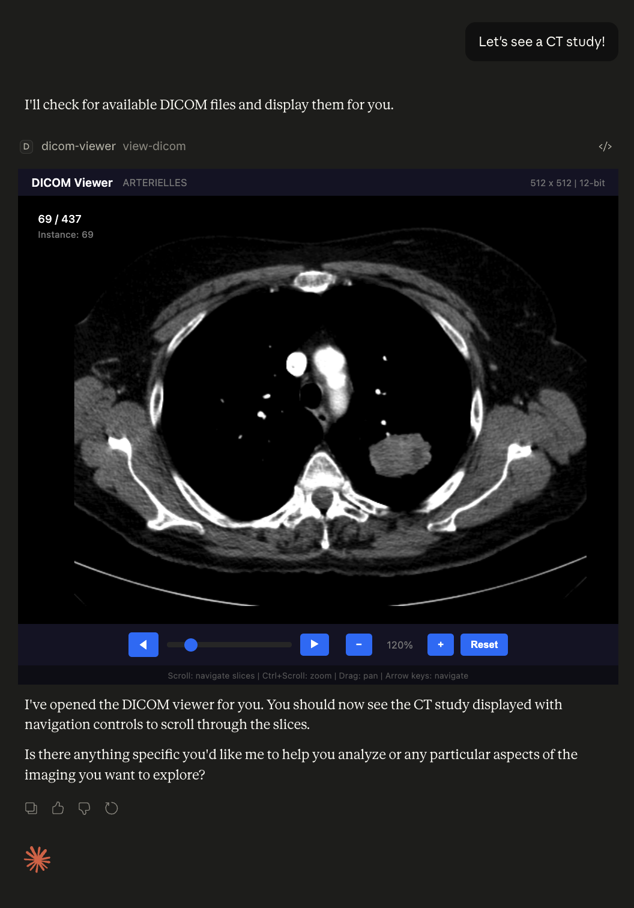
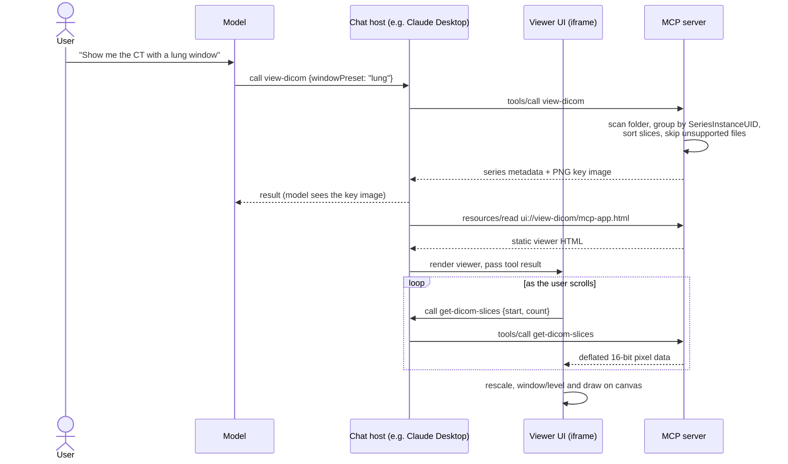

# DICOM Viewer MCP App

[](https://github.com/ThalesMMS/dicom-viewer-mcp-app/actions/workflows/ci.yml)

A prototype MCP (Model Context Protocol) App that displays DICOM medical images directly within LLM chat interfaces, including Claude Desktop. Built using the [MCP Apps SDK](https://github.com/modelcontextprotocol/ext-apps).

> [!WARNING]
> **For demonstration, education and research only.** This software is **not a medical device**. It is not cleared or approved by any regulatory body and must **not** be used for diagnosis, treatment, or any other clinical decision-making. Rendering may be incomplete or wrong (see [Limitations](#limitations)).

> [!IMPORTANT]
> **Privacy.** Use **de-identified** data only. The images you open are sent to the chat host (e.g. Claude Desktop) to be displayed, and the `view-dicom` tool result includes a **key image that the language model can see**, along with series and study descriptions. The server does not read patient-identifying tags and never sends them to the UI or the model, but identifiers burned into the pixels, or kept in tags the server does not know about, are not removed.



## Contents

- [Features](#features)
- [Prerequisites](#prerequisites)
- [Installation](#installation)
- [Getting DICOM data](#getting-dicom-data)
- [Use with Claude Desktop](#use-with-claude-desktop)
- [HTTP mode](#http-mode)
- [Tool reference](#tool-reference)
- [How it works](#how-it-works)
- [Controls](#controls)
- [DICOM support](#dicom-support)
- [Limitations](#limitations)
- [Troubleshooting](#troubleshooting)
- [Development](#development)

## Features

- View DICOM images directly inside the chat, with an interactive viewer
- **Multiple series** - every series in the folder is detected (grouped by SeriesInstanceUID) and can be selected
- **Geometric slice ordering** - slices are sorted along the scan direction using Image Position (Patient), falling back to Instance Number, Slice Location, then file name
- **Client-side window/level** - the viewer receives the original 16-bit values and applies window/level on a canvas, so adjusting contrast is instant; CT presets (soft tissue, lung, bone, brain, liver, mediastinum) included
- **On-demand loading** - pixel data is fetched in small pages as you scroll instead of all at once
- **The model sees what you see** - `view-dicom` returns series metadata and a PNG key image, and the viewer keeps the model informed (as text) of the slice and window you are looking at
- Pan, zoom, invert, fullscreen (where the host supports it), keyboard shortcuts and touch gestures
- Overlays with series information, the current window/level and zoom, orientation markers and a scale bar
- Files that cannot be displayed (for example compressed transfer syntaxes) are listed with the reason instead of failing silently
- Optional embedded mode for hosts without the MCP Apps bridge (e.g. Open WebUI)

## Prerequisites

- **Node.js 20.11 or newer** to build and run the server (`engines` in `package.json`). Node.js 20 has reached end of life, so Node.js 22 LTS or 24 is recommended.
- **Node.js 22.12 or newer** for the development tooling: `npm test` (Vitest 5) and `npm run dev` (concurrently 10) require it. `.nvmrc` selects Node 22.
- An MCP host that supports MCP Apps, such as Claude Desktop.

No other runtime (such as bun) and no native image libraries are needed.

## Installation

The package is not published to npm; install it from source:

```bash
# Clone the repository
git clone https://github.com/ThalesMMS/dicom-viewer-mcp-app.git
cd dicom-viewer-mcp-app

# Install dependencies (exact versions from package-lock.json)
npm ci

# Build the viewer UI and the server into dist/
npm run build
```

The build produces `dist/mcp-app.html` (the viewer, a single self-contained HTML file), `dist/server.js` and `dist/index.js` (the entry point, also exposed as the `mcp-server-dicom-viewer` bin).

Optional checks:

```bash
npm test           # unit tests (Vitest)
npm run lint       # ESLint
npm run typecheck  # TypeScript, no emit
```

## Getting DICOM data

The server reads DICOM files from one folder (not recursively): files ending in `.dcm` (any case) and files without an extension that carry the `DICM` signature. Hidden files are ignored. By default the folder is `./dicom` **relative to the current working directory**; use `--dir <path>` (or the `DICOM_DIR` environment variable) to point it at any other folder. Several series may live in the same folder.

### Synthetic sample series

To try the viewer without any real data, generate a small synthetic CT phantom (plain Node.js, no dependencies, nothing is downloaded):

```bash
node scripts/make-sample.mjs                       # writes into ./dicom
node scripts/make-sample.mjs --out /path/to/folder  # or anywhere else
```

It writes 40 slices of 256 x 256 (16-bit, uncompressed, CT Image Storage) showing a geometric phantom: an air background, a soft-tissue ellipse, two "lung" inserts that change size across the slices, a "spine", a "bone" sphere and a small rod on the patient's left. The patient name is `PHANTOM^SYNTHETIC`; it is obviously not patient data. Existing files are not overwritten unless you pass `--force`.

### Your own data

Copy (de-identified) uncompressed DICOM files into a folder and pass it with `--dir`:

```
my-study/
├── IM-0001-0001.dcm
├── IM-0001-0002.dcm
├── IM-0001-0003.dcm
└── ...
```

Many public datasets distribute compressed DICOM (JPEG, JPEG 2000, ...), which this viewer does not decode yet. You can convert such files to an uncompressed transfer syntax first, for example with GDCM (`gdcmconv --raw in.dcm out.dcm`, handles most compressed syntaxes) or, for JPEG only, DCMTK (`dcmdjpeg in.dcm out.dcm`).

Everything inside `./dicom` except the `.gitkeep` placeholder is ignored by git.

## Use with Claude Desktop

Add the server to your Claude Desktop configuration file:

| OS | Configuration file |
|----|--------------------|
| macOS | `~/Library/Application Support/Claude/claude_desktop_config.json` |
| Windows | `%APPDATA%\Claude\claude_desktop_config.json` |
| Linux (where a Claude Desktop build is available) | `~/.config/Claude/claude_desktop_config.json` |

Use **absolute paths** for both the entry point and `--dir`: Claude Desktop does not start the server in the project folder, so the default `./dicom` would not point where you expect.

**macOS / Linux:**

```json
{
  "mcpServers": {
    "dicom-viewer": {
      "command": "node",
      "args": [
        "/absolute/path/to/dicom-viewer-mcp-app/dist/index.js",
        "--stdio",
        "--dir",
        "/absolute/path/to/dicom-viewer-mcp-app/dicom"
      ]
    }
  }
}
```

**Windows** (backslashes must be escaped in JSON):

```json
{
  "mcpServers": {
    "dicom-viewer": {
      "command": "node",
      "args": [
        "C:\\Users\\you\\dicom-viewer-mcp-app\\dist\\index.js",
        "--stdio",
        "--dir",
        "C:\\Users\\you\\dicom-viewer-mcp-app\\dicom"
      ]
    }
  }
}
```

If `node` is not found (common when Node.js is installed through a version manager), replace `"node"` with the absolute path of the Node.js executable (`which node` on macOS/Linux, `where node` on Windows).

Then **fully quit and restart Claude Desktop** and ask, for example, "Show me the DICOM study" or "Use the view-dicom tool".

## HTTP mode

Without `--stdio` the server listens for [Streamable HTTP](https://modelcontextprotocol.io/specification/2025-06-18/basic/transports#streamable-http) at:

```
http://127.0.0.1:3001/mcp
```

```bash
node dist/index.js --dir ./dicom
# or, from source with auto-reload:
npm run serve
```

> [!CAUTION]
> The HTTP endpoint has **no authentication**. Anyone who can reach it can read every image in the DICOM folder. It binds to `127.0.0.1` by default, where the MCP SDK's DNS-rebinding (Host header) protection is active. Do not bind it to `0.0.0.0` or another non-loopback address, or expose it through a tunnel or reverse proxy, unless the network is trusted or an authenticating proxy sits in front (the server prints a warning when you do). Keep CORS closed unless you need it.

### Command-line options and environment variables

```
node dist/index.js [--stdio] [--dir <path>] [--embed-series] [--host <host>] [--port <port>]
```

Command-line flags take precedence over environment variables. `node dist/index.js --help` prints the same list.

| Option | Environment variable | Default | Description |
|--------|----------------------|---------|-------------|
| `--stdio` | | off (HTTP) | Use the stdio transport (what Claude Desktop expects) instead of Streamable HTTP |
| `--dir <path>` | `DICOM_DIR` | `./dicom` | DICOM folder. Precedence: `--dir`, then `DICOM_DIR`, then `./dicom` relative to the current working directory |
| `--embed-series` | `DICOM_EMBED=1` | off | Embed the default series in the viewer HTML (see below). `DICOM_EMBED` also accepts `true`, `yes`, `on` |
| `--host <host>` | `HOST` | `127.0.0.1` | HTTP bind address |
| `--port <port>` | `PORT` | `3001` | HTTP port |
| | `CORS_ORIGIN` | none | Comma-separated allow-list of origins permitted to call the HTTP endpoint from a browser; CORS is disabled when unset |
| `-h`, `--help` | | | Show help and exit |

### Hosts without the MCP Apps bridge (Open WebUI)

Hosts such as Open WebUI can render the viewer HTML but cannot run the app-only tool calls it normally uses to fetch pixel data. Start the server with `--embed-series` (or `DICOM_EMBED=1`) and the default series (all its slices) is embedded directly into the HTML resource, so the viewer works without calling back into the server. Only the default series is available in this mode, and the HTML becomes as large as the series, so keep it to small series.

## Tool reference

### `view-dicom` (visible to the model)

Opens the viewer on a series. All arguments are optional.

| Argument | Type | Description |
|----------|------|-------------|
| `seriesInstanceUid` | string | Series to open. Defaults to the series with the most slices |
| `windowPreset` | `soft-tissue` \| `lung` \| `bone` \| `brain` \| `liver` \| `mediastinum` | Initial window preset (CT values in HU) |
| `windowCenter` | number | Explicit window center; must be given together with `windowWidth` and overrides `windowPreset` |
| `windowWidth` | number | Explicit window width |

Presets (center / width, HU): soft tissue 40 / 400, lung -600 / 1500, bone 400 / 1800, brain 40 / 80, liver 60 / 160, mediastinum 50 / 350.

Without a window argument the series default is used: the window stored in the files, or one derived from the pixel range when the files have none.

The result contains:

- a text summary for the model: the series found (UID, description, modality, number of slices, matrix size), the selected series (photometric interpretation, bits stored, pixel spacing, slice thickness, window) and the skipped files with the reason;
- a **PNG key image**: the middle slice of the selected series rendered with the chosen window (at most 512 px on the long side), which the model can look at;
- `structuredContent` for the viewer: the same metadata plus per-slice positions (`ViewDicomResult` in [`shared/protocol.ts`](shared/protocol.ts)).

No patient identifiers are included. Errors (folder missing, no files, every file unsupported, unknown series UID) come back as tool errors with a hint on how to fix them.

Example prompts:

- "Show me the DICOM images."
- "Which series are in the folder? Open the one with the most slices."
- "Open the CT with the lung window."
- "View the series with a window center of 300 and width of 1500."
- "Some files were skipped. Why?"

### `get-dicom-slices` (app-only)

Called by the viewer, not by the model, to page pixel data: `seriesInstanceUid`, a zero-based `start` index and a `count` of at most 8 slices per call. Each slice is returned as zlib-deflated, base64-encoded raw samples plus rescale slope/intercept and an invert flag (for MONOCHROME1). The data contract is defined in [`shared/protocol.ts`](shared/protocol.ts).

## How it works



1. The server scans the DICOM folder, parses each `.dcm` file with [`dicom-parser`](https://github.com/cornerstonejs/dicomParser), groups files into series by SeriesInstanceUID and sorts slices geometrically. Files it cannot display are recorded with the reason.
2. `view-dicom` returns metadata about the series and a PNG key image (the middle slice, rendered with the requested window). No patient identifiers are read or returned. Parsed metadata and decoded pixels are cached, so later calls are fast.
3. The viewer is a static `ui://` HTML resource (React, bundled into one file with Vite). It receives the tool result from the host and requests pixel data through the app-only `get-dicom-slices` tool, a few slices at a time.
4. Pixel data travels as the original stored values (8/16-bit grayscale, or RGB), masked to BitsStored and deflated. The viewer applies rescale slope/intercept and window/level itself, so changing contrast needs no round trip to the server.
5. Choosing another series in the viewer calls `view-dicom` again from the UI. As you browse, the viewer reports the current slice and window to the model as text (`updateModelContext`), so follow-up questions refer to what is on screen.
6. With `--embed-series`, step 3 is skipped: the default series is embedded in the HTML (serialized so it cannot break out of its `<script>` element) and no tool calls are made.

## Controls

Click the image first so it has keyboard focus.

| Action | Control |
|--------|---------|
| Window/level | Left-drag with the window/level tool (the default for grayscale): horizontal changes the width, vertical the center. Right-drag adjusts window/level with any tool |
| Pan | Pan tool + left-drag, middle-drag, or Shift + drag |
| Zoom | Ctrl/Cmd + scroll wheel (anchored at the cursor), zoom tool + vertical drag, `+` / `-` keys or buttons, two-finger pinch on touch devices |
| Next / previous slice | Scroll wheel, slider, ◀/▶ buttons, arrow keys |
| Jump 10 slices | Page Up / Page Down |
| First / last slice | Home / End |
| Window preset | Presets dropdown (Default, soft tissue, lung, bone, brain, liver, mediastinum) |
| Invert | `I` or the invert button |
| Reset zoom/pan and window | `0` or `R`, or the reset button |
| Reset zoom/pan only | Double-click the image |
| Switch series | Series dropdown (shown when the folder has more than one series) |
| Fullscreen | Fullscreen button, when the host offers it; Esc to leave |
| Overlays | Toggle button for the series information, window/level, zoom, orientation markers and scale bar |
| Skipped files | A warning badge appears when files were skipped; click it for the list and reasons |

Color images (RGB, YBR, palette) have no window/level or invert; the default tool is pan.

## DICOM support

| Feature | Supported |
|---------|-----------|
| Implicit VR Little Endian, Explicit VR Little Endian, Deflated Explicit VR Little Endian, Explicit VR Big Endian | Yes |
| Compressed transfer syntaxes: JPEG (baseline, extended, lossless), JPEG-LS, JPEG 2000 / HTJ2K, JPEG XL, RLE, MPEG/H.264/HEVC video | **No** - files are skipped and listed with the reason |
| Several series in one folder | Yes, grouped by SeriesInstanceUID and selectable |
| Multi-frame images | Yes, each frame is a slice (per-frame positions are used when present) |
| MONOCHROME1 / MONOCHROME2 | Yes (MONOCHROME1 is inverted after windowing) |
| Grayscale bit depth | 8-bit and 16-bit allocated, signed and unsigned, Bits Stored < Bits Allocated (masked and sign-extended) |
| Color | RGB and YBR_FULL (8-bit, interleaved or planar) and PALETTE COLOR, converted to RGB by the server; segmented palettes are not supported |
| Rescale slope / intercept | Yes (per slice) |
| Window center / width from the file | Yes (default window; derived from the pixel range when absent) |
| Slice ordering | Image Position (Patient) along the slice normal when the orientation is consistent, else Instance Number, else Slice Location, else file name |
| Duplicate SOP Instance UIDs | The duplicate is skipped and listed |
| Non-image objects (DICOMDIR, SR, files without Pixel Data) | Skipped and listed |

## Limitations

- Compressed DICOM is not decoded (see [DICOM support](#dicom-support)); convert it first.
- No measurements, annotations, MPR/3D or fusion; one 2D slice at a time.
- No authentication in HTTP mode (see [HTTP mode](#http-mode)).
- Large series take longer to scan the first time, and in `--embed-series` mode the whole series is inlined into the HTML.
- Not validated for clinical use; see the warning at the top.

## Troubleshooting

**"No DICOM files found" or "DICOM directory not found"**
- Check which folder the server is reading: it prints `[dicom-viewer] DICOM directory: ...` to stderr at startup (visible in the Claude Desktop MCP log), and the tool error names the folder. Pass an absolute `--dir`: with Claude Desktop the working directory is not the project folder, so the default `./dicom` usually points somewhere else.
- Only files directly inside the folder are read (no subfolders), and only files ending in `.dcm` or without an extension. Files with other extensions (e.g. `.dicom`, `.ima`) must be renamed. Or generate the sample series with `node scripts/make-sample.mjs`.

**All files are skipped / "Unsupported transfer syntax"**
- The files are compressed (JPEG, JPEG-LS, JPEG 2000, RLE). Decompress them, e.g. `gdcmconv --raw in.dcm out.dcm` (GDCM) or, for JPEG, `dcmdjpeg in.dcm out.dcm` (DCMTK). The viewer's skipped-files badge and the tool result list the reason for each file.

**The tool does not appear in Claude Desktop**
- Make sure `npm run build` finished and `dist/index.js` exists.
- Check that the configuration file is valid JSON (Windows paths need `\\`) and that the paths are absolute.
- Fully quit Claude Desktop (not just close the window) and start it again.
- Look at the MCP logs: `~/Library/Logs/Claude/mcp*.log` on macOS, `%APPDATA%\Claude\logs\mcp*.log` on Windows.
- Run the server by hand to see errors: `node dist/index.js --stdio --dir /path/to/dicom`. When it works it prints the DICOM directory to stderr and then waits for input; stop it with Ctrl+C.

**The viewer opens but stays empty in Open WebUI or another host**
- The host probably does not implement the MCP Apps bridge. Start the server with `--embed-series`.

## Development

```bash
npm run dev      # rebuild the UI on change (vite --watch) and run the server with tsx watch (HTTP mode)
npm start        # one development build, then serve
npm run build    # production build into dist/
npm test         # Vitest
npm run lint     # ESLint
npm run typecheck
```

`npm run dev` / `npm run serve` run `main.ts` directly with `tsx` in HTTP mode at `http://127.0.0.1:3001/mcp`. Pass options after `--`, e.g. `npm run serve -- --dir ./dicom`. You can connect to it with any MCP client that supports Streamable HTTP, such as the [MCP Inspector](https://github.com/modelcontextprotocol/inspector) or the `basic-host` example in the ext-apps repository.

CI (GitHub Actions) runs lint, type-check, tests and build on Ubuntu with Node 22 and 24 and on Windows with Node 22, and smoke-tests the built server on Node 20.

### Project structure

```
dicom-viewer-mcp-app/
├── dicom/                   # Default DICOM folder (contents git-ignored)
│   └── .gitkeep
├── shared/
│   └── protocol.ts          # Data contract shared by server and UI (tool names, types, presets)
├── main.ts                  # Entry point: CLI options, stdio / HTTP transports
├── server.ts                # createServer(): registers the ui:// resource and both tools
├── server/
│   ├── cli.ts               # Flags, environment variables, --help text
│   ├── catalog.ts           # Folder scan, caching, series grouping and slice sorting
│   ├── dicom.ts             # Metadata extraction (no patient identifiers) and pixel decoding
│   ├── transfer-syntax.ts   # Supported / unsupported transfer syntaxes
│   ├── tools.ts             # view-dicom and get-dicom-slices handlers
│   ├── render.ts, png.ts    # Key-image rendering and PNG encoding (no native dependencies)
│   ├── embed.ts             # Safe injection of the --embed-series payload
│   └── lru.ts, version.ts
├── src/                     # Viewer UI (React)
│   ├── mcp-app.tsx          # App shell: host connection, series switching, fullscreen
│   ├── components/          # Viewer, Viewport (canvas + pointer/wheel), Overlays, SkippedBadge, ...
│   ├── hooks/               # Slice loading, model-context updates
│   ├── host/                # Tool calls to the server
│   ├── viewer/              # Decoding, LUT/window-level, geometry, paging cache (+ unit tests)
│   ├── mcp-app.module.css
│   └── global.css
├── tests/                   # Server tests (Vitest) and helpers that write DICOM test files
├── scripts/
│   ├── build-server.mjs     # Bundles the server with esbuild
│   └── make-sample.mjs      # Generates the synthetic sample series
├── mcp-app.html             # Vite entry for the viewer
├── vite.config.ts           # Single-file UI build
├── vitest.config.ts
├── eslint.config.js
└── package.json
```

## Citation

If you use this software, please cite it using the metadata in [CITATION.cff](CITATION.cff):

```text
Thales Matheus Mendonça Santos. DICOM Viewer MCP App. Version 1.0.0. 2026-06-08. https://github.com/ThalesMMS/dicom-viewer-mcp-app
```

## Author

**Thales Matheus Mendonça Santos** - [GitHub](https://github.com/ThalesMMS)

## License

MIT
